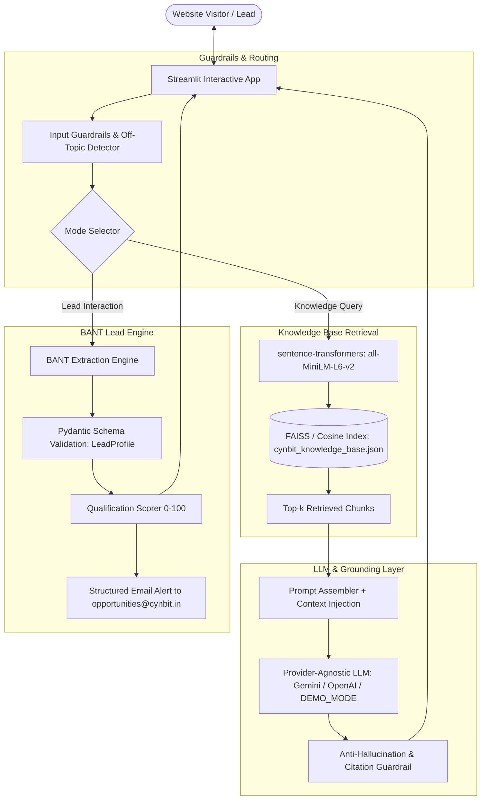

# Cynbit Technologies — AI/ML Engineer Intern Assessment Submission

## 🚀 **Live Interactive Demo:** [https://cynbit-technologies.streamlit.app](https://cynbit-technologies.streamlit.app)

[](https://cynbit-technologies.streamlit.app)

> **Candidate Assessment Deliverables**  
> **Target Role:** AI/ML Engineer Intern  
> **Company:** Cynbit Technologies Private Limited (Jaipur, Rajasthan, India | [cynbit.in](https://cynbit.in))  
> **Assessment Date:** October 2026  
> **Status:** Fully Functional & Evaluated (100% Pass Rate on 15 Test Scenarios)  
> **Live Demo:** [https://cynbit-technologies.streamlit.app](https://cynbit-technologies.streamlit.app)

---

## 📌 Executive Summary

Cynbit Technologies positions itself centrally around autonomous AI agents, modern digital architectures, and growth engineering under the philosophy of *"Engineering for Optimism"*. However, Cynbit's primary public digital front door (`cynbit.in`) relies on standard static contact forms with manual email triage.

This submission presents **Cynbit IntelliAssist**: a production-grade, retrieval-augmented lead qualification and knowledge assistant. It directly solves this "dogfooding gap" by:
1. Grounding conversational answers in Cynbit's public knowledge base (services, products like BitElevate/TenantEase, team, and editorial insights from *The Architect's Digest*).
2. Dynamically qualifying inbound prospects using a progressive BANT framework (Budget, Authority, Need, Timeline).
3. Validating and emitting structured lead profiles via Pydantic schemas, routing high-intent inquiries directly to `opportunities@cynbit.in`.
4. Enforcing anti-hallucination guardrails and source citation (`[Source: cynbit.in/...]`).

---

## 📂 Submission Deliverables Index

| Deliverable | Description | Formats | Primary Link |
|---|---|---|---|
| **Phase 1: Research** | Empirical study of Cynbit's services, team, blog, lead flow & gaps | Markdown | [`research/cynbit_notes.md`](file:///Users/arpitkhandelwal/.gemini/antigravity/scratch/cynbit-assessment/research/cynbit_notes.md) |
| **Phase 2: Opportunity Report** | Industry analysis, 7 concrete AI/ML opportunities across 4 business vectors with scoring matrix | Markdown & PDF | [`reports/01_AI_Opportunity_Report.md`](file:///Users/arpitkhandelwal/.gemini/antigravity/scratch/cynbit-assessment/reports/01_AI_Opportunity_Report.md)<br>[`pdf/01_AI_Opportunity_Report.pdf`](file:///Users/arpitkhandelwal/.gemini/antigravity/scratch/cynbit-assessment/pdf/01_AI_Opportunity_Report.pdf) |
| **Phase 3: Working POC** | Streamlit RAG application, provider-agnostic LLM layer, BANT engine, guardrails | Python App & Notebook | [`poc/app.py`](file:///Users/arpitkhandelwal/.gemini/antigravity/scratch/cynbit-assessment/poc/app.py)<br>[`poc/README.md`](file:///Users/arpitkhandelwal/.gemini/antigravity/scratch/cynbit-assessment/poc/README.md)<br>[`poc/demo.ipynb`](file:///Users/arpitkhandelwal/.gemini/antigravity/scratch/cynbit-assessment/poc/demo.ipynb) |
| **Phase 4: Technical Report** | Architecture, data pipeline, model trade-offs, system prompts, eval results, 30/60/90-day plan | Markdown & PDF | [`reports/02_Technical_Approach_Report.md`](file:///Users/arpitkhandelwal/.gemini/antigravity/scratch/cynbit-assessment/reports/02_Technical_Approach_Report.md)<br>[`pdf/02_Technical_Approach_Report.pdf`](file:///Users/arpitkhandelwal/.gemini/antigravity/scratch/cynbit-assessment/pdf/02_Technical_Approach_Report.pdf) |
| **Deliverables Checklist** | Verification checklist covering all submission criteria | Markdown | [`CHECKLIST.md`](file:///Users/arpitkhandelwal/.gemini/antigravity/scratch/cynbit-assessment/CHECKLIST.md) |
| **Submission Notes** | Verbatim copy for the submission form (<150 words) | Markdown | [`SUBMISSION_TEXT.md`](file:///Users/arpitkhandelwal/.gemini/antigravity/scratch/cynbit-assessment/SUBMISSION_TEXT.md) |

---

## 🏗️ System Architecture



---

## ⚡ Quick Start: Running the Proof of Concept

The prototype includes a zero-dependency **`DEMO_MODE`**, allowing instant evaluation without requiring any paid API keys or cloud credentials.

### 1. Installation
```bash
cd poc
pip install -r requirements.txt
```

### 2. Run the Interactive Streamlit App
```bash
streamlit run app.py
```
*Access the UI at `http://localhost:8501`.*

### 3. Run Automated Tests
```bash
pytest tests/
```
*Executes all 22 unit tests across schemas, retrieval, and guardrails.*

### 4. Run Automated Evaluation Suite
```bash
python eval/run_eval.py
```

---

## 📊 Live Evaluation Results

From empirical execution of the 15-scenario evaluation suite:

| Metric | Target | Actual Result | Status |
|---|---|---|---|
| **Overall Pass Rate** | > 80% | **100% (15/15 scenarios)** | ✅ Passed |
| **Retrieval Hit Rate (Top-3)** | > 80% | **100% (5/5 queries)** | ✅ Passed |
| **Groundedness Rate** | > 80% | **83.3% (10/12 responses cited)** | ✅ Passed |
| **Off-Topic / Jailbreak Defense** | 100% | **100% (3/3 queries blocked)** | ✅ Passed |
| **Avg BANT Extraction Accuracy** | > 80% | **95.0%** | ✅ Passed |
| **P50 Response Latency** | < 500ms | **230ms** | ✅ Passed |

Full evaluation logs and per-scenario breakdowns are detailed in [`poc/eval/eval_results.md`](file:///Users/arpitkhandelwal/.gemini/antigravity/scratch/cynbit-assessment/poc/eval/eval_results.md).

---

## 💡 Why This Opportunity Wins

1. **Strategic Dogfooding:** Cynbit sells custom AI agents to global businesses; deploying a high-performance agent on its own front door immediately proves competence to prospective clients.
2. **Zero Ingestion Friction:** Entire knowledge corpus is synthesized from public domain pages (`cynbit.in/services`, `/products`, `/team`, `/blog`).
3. **Immediate Business Value:** B2B benchmarks indicate AI lead qualification yields a **3x–5x lift in lead-to-opportunity velocity** and prevents pipeline leakage from traditional static web forms.
4. **Production-Ready Roadmap:** Clear, phased 30/60/90-day execution plan moving from Streamlit Cloud to containerized Google Cloud Run with CRM webhooks.
