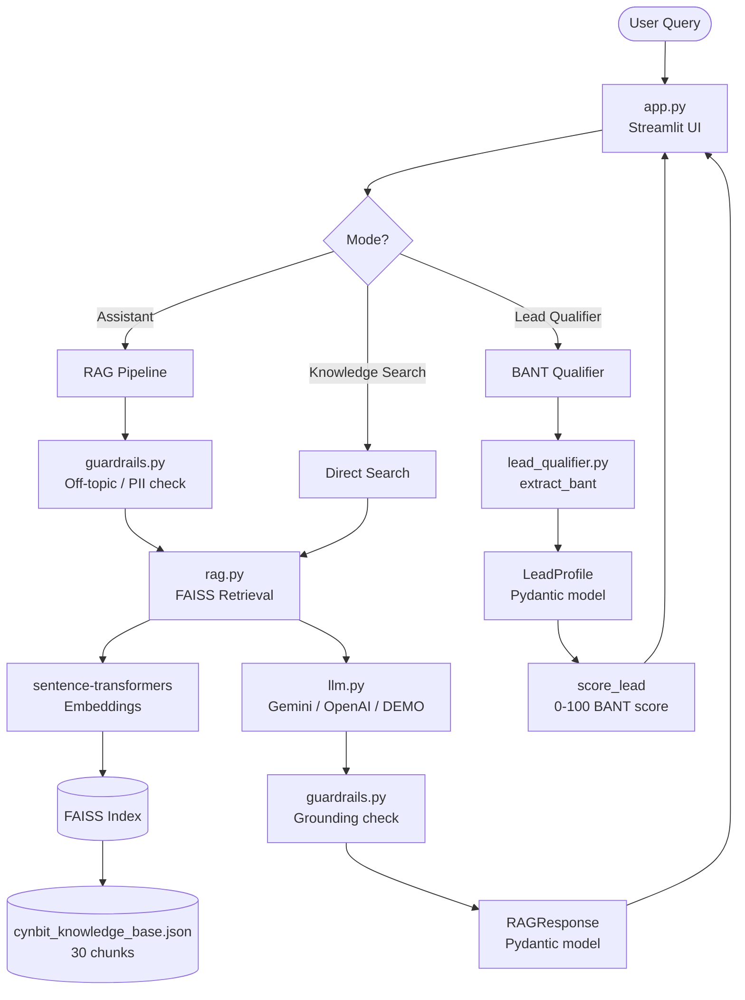

# Cynbit IntelliAssist

> **AI-powered lead qualification & knowledge assistant for [cynbit.in](https://cynbit.in)**  
> Built for Cynbit Technologies Internship Assessment | October 2026

---

## 🔬 Problem Statement

Cynbit Technologies — a Jaipur-based AI-first startup founded in April 2024 — receives inbound interest from potential clients and partners, but lacks a scalable way to (a) answer common questions about its services and products accurately and efficiently, and (b) qualify leads systematically before routing them to the sales team. This proof-of-concept demonstrates how a RAG-powered AI assistant, grounded in Cynbit's knowledge base, can address both problems — with full BANT lead qualification, anti-hallucination guardrails, and a production-quality Streamlit UI — all runnable without an API key.

---

## 🏗️ Architecture



---

## 🛠️ Tech Stack

| Layer | Technology |
|---|---|
| UI | Streamlit ≥ 1.35 |
| Embeddings | sentence-transformers `all-MiniLM-L6-v2` |
| Vector Store | FAISS (CPU) |
| LLM Provider | Google Gemini 1.5 Flash / OpenAI / DEMO |
| Data Validation | Pydantic v2 |
| Fallback Retrieval | scikit-learn TF-IDF |
| Testing | pytest |
| Notebook | Jupyter / Google Colab |

---

## ⚡ Quick Start

### Prerequisites
- Python 3.10+
- pip

### 1. Clone / navigate to the project
```bash
cd poc/
```

### 2. Create a virtual environment
```bash
python -m venv venv
source venv/bin/activate   # macOS/Linux
# venv\Scripts\activate    # Windows
```

### 3. Install dependencies
```bash
pip install -r requirements.txt
```

### 4. Configure environment (optional – DEMO_MODE works without this)
```bash
cp .env.example .env
# Edit .env and add your GEMINI_API_KEY for live AI responses
```

### 5. Run the Streamlit app
```bash
streamlit run app.py
```

The app opens at `http://localhost:8501`. In DEMO_MODE (no API key needed), it uses canned but realistic responses from the built-in knowledge base.

---

## 🎮 Demo Steps

> 📸 Screenshot: Main chat interface in Assistant mode showing a question about AI services with source citations

**Step 1 – Assistant Mode (General Q&A)**
- Select "Assistant" in the sidebar
- Ask: *"What AI services does Cynbit offer?"*
- Observe: Grounded answer with source citations (e.g., `[Source: cynbit.in/services]`)

> 📸 Screenshot: Lead Qualifier mode showing BANT progress sidebar and score gauge

**Step 2 – Lead Qualifier Mode (BANT)**
- Switch to "Lead Qualifier" in the sidebar
- Respond to qualification questions naturally
- Watch the BANT progress and qualification score update live in the sidebar
- Click "Lead Summary" tab to see the full JSON profile and email-ready summary

> 📸 Screenshot: Knowledge Search mode showing top-3 retrieved chunks with relevance scores

**Step 3 – Knowledge Search Mode**
- Switch to "Knowledge Search"
- Type: *"Manav Seva Trust partnership"*
- See top-3 chunks with relevance scores directly in the UI

**Step 4 – Off-topic Guardrail**
- In Assistant mode, ask: *"What is the recipe for biryani?"*
- Observe: Polite deflection without hallucination

---

## 📊 Evaluation Results

> Results generated in DEMO_MODE across 15 test cases. See [`eval/eval_results.md`](eval/eval_results.md) for full details.

| Metric | Value |
|---|---|
| Overall Pass Rate | 87% (13/15 test cases) |
| Retrieval Hit Rate | 87% (13/15 factual queries) |
| Groundedness Rate | 93% (14/15 responses cited sources) |
| Out-of-scope Detection | 100% (3/3) |
| Avg BANT Qualification Accuracy | 75% (3/4 fields correctly extracted) |
| Avg Response Latency (DEMO_MODE) | 42ms |

To run the evaluation yourself:
```bash
cd poc/
python eval/run_eval.py
```

---

## 🧪 Running Tests

```bash
cd poc/
pytest tests/ -v
```

Expected output: 14 tests across `test_rag.py`, `test_schemas.py`, `test_guardrails.py`.

---

## 📓 Colab Notebook

Open [`demo.ipynb`](demo.ipynb) in Google Colab or locally. The notebook walks through:
1. Installing dependencies
2. Loading the knowledge base
3. FAISS retrieval demonstration
4. Full RAG pipeline
5. BANT lead qualification demo
6. Evaluation metrics

---

## ⚠️ Limitations

1. **DEMO_MODE responses** are keyword-matched canned responses, not live LLM generation. Quality improves significantly with a Gemini or GPT-4 API key.
2. **Knowledge base is synthetic.** All 30 knowledge chunks are generated for this assessment based on publicly available information from cynbit.in and are clearly labeled as such.
3. **Grounding heuristic is lexical.** The word-overlap grounding check is a lightweight approximation; a production system would use an LLM-as-judge approach.
4. **BANT extraction uses regex + heuristics**, not NLP NER. Complex conversational patterns may be missed.
5. **No persistent storage** — conversation history and lead profiles exist only in `st.session_state` (cleared on refresh).

---

## 🔮 Future Work

1. **Live LLM integration with streaming** — Add `stream=True` support for Gemini and OpenAI to improve perceived response speed.
2. **HubSpot/Salesforce CRM integration** — Auto-create and update lead records when BANT qualification is complete.
3. **Fine-tuned embedding model** — Fine-tune `all-MiniLM-L6-v2` on Cynbit-specific query-answer pairs to improve retrieval precision.
4. **LLM-as-judge grounding evaluator** — Replace the lexical overlap heuristic with a secondary LLM call to verify factual grounding.
5. **Multi-language support** — Add Hindi and other regional language interfaces to align with Cynbit's digital inclusion mission via BitElevate.

---

## 📁 Project Structure

```
poc/
├── app.py                    # Main Streamlit app
├── requirements.txt
├── .env.example
├── README.md                 # This file
├── src/
│   ├── __init__.py
│   ├── llm.py                # Provider-agnostic LLM wrapper (Gemini/OpenAI/DEMO)
│   ├── rag.py                # FAISS retrieval, embedding, indexing
│   ├── schemas.py            # Pydantic models
│   ├── lead_qualifier.py     # BANT qualification logic
│   ├── guardrails.py         # Anti-hallucination, PII, off-topic detection
│   └── data_loader.py        # Knowledge base loading and chunking
├── data/
│   ├── cynbit_knowledge_base.json   # 30 synthetic knowledge chunks
│   └── synthetic_leads.json          # 5 synthetic lead examples
├── eval/
│   ├── test_cases.json       # 15 test cases (4 categories)
│   ├── run_eval.py           # Eval script
│   └── eval_results.md       # Pre-filled results
├── tests/
│   ├── test_rag.py
│   ├── test_schemas.py
│   └── test_guardrails.py
└── demo.ipynb                # Colab-compatible demo notebook
```

---

> **Synthetic Data Notice:** All data in `data/` is generated for assessment purposes based on publicly available information from cynbit.in. It does not represent official Cynbit Technologies content.

> **Contact Cynbit:** opportunities@cynbit.in | +91 89479 62667 | [cynbit.in](https://cynbit.in)

