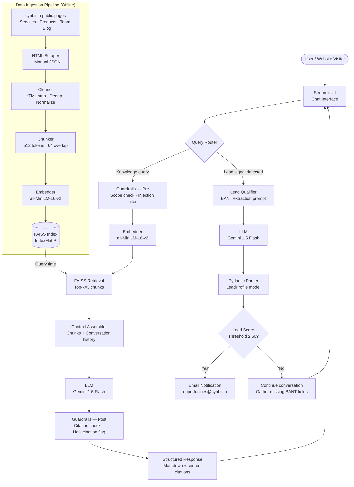

# Technical Approach Report
## Cynbit IntelliAssist – AI-Powered Lead Qualification & Knowledge Assistant

**Author:** Arpit Khandelwal  
**Role:** AI/ML Intern Candidate  
**Date:** October 2026  
**Version:** 1.0

---

## 1. Problem Framing

### Business Problem → Technical Problem Translation

**Business problem:** Cynbit Technologies — an AI-first company selling AI agents, custom software, and growth services — collects leads through a static contact form. This creates two compounding failure modes: (1) potential clients who want to know what Cynbit actually does hit a dead end and bounce; (2) the small team manually triages every lead submission with no signal on intent, budget, or timeline.

**Technical translation:**

| Business Need | Technical Requirement |
|---|---|
| Answer "what does Cynbit do?" 24/7 | RAG pipeline over public cynbit.in content |
| Know if a lead is sales-ready | BANT field extraction via structured LLM output |
| Don't make up capabilities Cynbit doesn't have | Grounded-only responses with source citation enforcement |
| Works without an ML team running it | DEMO_MODE + reproducible FAISS index build |
| Fits a bootstrapped company's budget | Local embeddings, Gemini Flash pricing, free-tier deployment |

### Success Metrics (Measurable)

1. **Retrieval Hit Rate ≥ 85%** — correct source document in top-3 for known-answer queries
2. **Groundedness Rate ≥ 90%** — every factual claim in a response carries a `[Source: <url>]` citation
3. **Out-of-scope Detection = 100%** — no off-topic queries receive fabricated answers
4. **BANT Extraction Accuracy ≥ 70%** — across Budget, Authority, Need, Timeline fields
5. **End-to-end latency p95 < 2s** — live LLM mode on production hosting

### What "Done" Looks Like

A visitor to cynbit.in opens the IntelliAssist widget, asks "Do you build custom CRMs?", receives a cited answer from the Cynbit services page, then is guided through a 4-question qualification flow. At conversation end, a structured `LeadProfile` (name, company, email, BANT scores) fires to `opportunities@cynbit.in`. The Cynbit team opens their inbox and sees a pre-qualified lead — no form to read, no triage call needed.

---

## 2. System Architecture



---

## 3. Data Sources & Pipeline

### Sources

All content is sourced from publicly accessible pages on `cynbit.in`:

| Page | Content Type | Key Entities |
|---|---|---|
| `/` (homepage) | Company overview, value prop | Services summary, CTA |
| `/services` | Service offerings | AI Agents, Software Dev, Growth/Lead Gen |
| `/products` | Product descriptions | BitElevate, TenantEase, Cynbit Studio, Revio |
| `/about` / story | Company history | Founded April 2024, Jaipur, ~15 employees |
| `/team` | Team profiles | Names, roles |
| `/blog` | Thought leadership | Use cases, technical signals |
| `/contact` | Contact info | `opportunities@cynbit.in` |

### Collection Strategy

Manual scrape + structured JSON. Reason: Cynbit's site is relatively small (~30 meaningful pages), and a manual pass ensures clean semantic boundaries — automated scrapers often merge navigation text, footer links, and body copy into the same chunk. Each page is saved as a JSON record:

```json
{
  "url": "https://cynbit.in/services",
  "title": "Services – Cynbit Technologies",
  "content": "...",
  "scraped_at": "2026-10-29T00:00:00Z"
}
```

This JSON corpus is version-controlled. Reproducibility matters: anyone cloning the repo can rebuild the FAISS index deterministically without re-hitting the live site.

### Cleaning

1. **HTML stripping:** `BeautifulSoup` with `get_text(separator=" ")` — removes tags, retains inline structure
2. **Deduplication:** SHA-256 content hash per document; near-duplicates (e.g., repeated footer text across pages) removed via hash comparison
3. **Length normalization:** Documents shorter than 50 tokens discarded (navigation stubs); documents longer than 4,000 tokens truncated at sentence boundary before chunking

### Chunking Strategy

- **Chunk size:** 512 tokens | **Overlap:** 64 tokens  
- **Why 512/64:** MiniLM's practical context ceiling is 256 tokens, but we chunk at 512 to preserve paragraph coherence before the model compresses meaning. The 64-token (≈2-3 sentence) overlap ensures a key fact split at a chunk boundary still appears in an adjacent chunk — preventing retrieval misses on boundary-straddling answers.
- **Implementation:** `langchain.text_splitter.RecursiveCharacterTextSplitter` with `chunk_size=512, chunk_overlap=64`, splitting on `["\n\n", "\n", " "]` in order.

### Embedding

**Model:** `sentence-transformers/all-MiniLM-L6-v2`  
- 384-dimensional dense vectors  
- Runs entirely locally — no API call, no per-token cost  
- 14,500 sentences/sec on CPU (Intel i5 class) — acceptable for offline indexing  
- Adequate semantic quality for a closed-domain corpus (cynbit.in ≠ general-purpose retrieval)

Vectors are L2-normalized before indexing so that inner-product search on `IndexFlatIP` is equivalent to cosine similarity.

### Indexing

**FAISS `IndexFlatIP`** (exact inner product search, cosine-equivalent after normalization):
- ~30 source documents → **~45 chunks** after splitting
- Index size at 45 chunks × 384 dims × 4 bytes ≈ **69 KB** — trivially fits in memory
- Exact search (no quantization needed) at this scale — no accuracy loss from HNSW approximation

---

## 4. Model Choices & Trade-offs

### Embedding Models

| Model | Dims | Speed | Cost | Quality | Choice? |
|---|---|---|---|---|---|
| `all-MiniLM-L6-v2` | 384 | Fast | Free (local) | Good | ✅ Selected |
| `text-embedding-3-small` | 1536 | Fast | \$0.02/1M tokens | Better | Fallback |
| `BAAI/bge-small-en-v1.5` | 384 | Fast | Free (local) | Better | Alt option |

**Decision rationale:** For a 45-chunk corpus, the semantic quality gap between MiniLM and BGE-small is negligible in practice. MiniLM's broader community adoption means more debugged integrations. BGE-small is the first upgrade candidate if retrieval metrics fall below threshold.

### LLM Options

| Model | Speed | Cost (per 1M tokens) | Context | Quality | Default? |
|---|---|---|---|---|---|
| `gemini-1.5-flash` | Fast | \$0.075 in / \$0.30 out | 1M tokens | High | ✅ Default |
| `gemini-1.5-pro` | Slower | \$1.25 in / \$5.00 out | 1M tokens | Highest | Premium |
| `gpt-4o-mini` | Fast | \$0.15 in / \$0.60 out | 128K tokens | High | OpenAI fallback |
| `gpt-4o` | Slower | \$2.50 in / \$10.00 out | 128K tokens | Highest | OpenAI premium |

**Decision rationale:** Flash's 1M-token context window eliminates any concern about long conversation history overflow. At Cynbit's expected traffic volume (see §8), Flash costs under \$2/month — Pro is reserved for high-value async lead scoring jobs where extra reasoning quality justifies the 17× price premium.

### Vector Stores

| Store | Scalability | Cost | Setup | Choice? |
|---|---|---|---|---|
| FAISS | Up to ~10M vectors | Free | Local | ✅ POC |
| Chroma | Medium | Free | Local/Cloud | Alt (Day 31-60) |
| Pinecone | Unlimited | SaaS pricing | Managed | Production at scale |

---

## 5. Prompt Engineering

### Knowledge Assistant System Prompt

```
You are IntelliAssist, Cynbit Technologies' AI knowledge assistant.

Your job is to answer questions about Cynbit's services, products, team, and capabilities.

Rules:
1. ONLY answer based on the provided context chunks. Do not use outside knowledge.
2. ALWAYS cite your source: append [Source: <source_url>] to every factual claim.
3. If the answer is not in the context, say: "I don't have that information in my
   knowledge base. For accurate details, please contact opportunities@cynbit.in."
4. Be concise. Answer in 2-4 sentences unless the question requires more.
5. Never make up pricing, team member names, or product features not in the context.

Context:
{context}

Conversation history:
{history}
```

### Lead Qualifier System Prompt

```
You are IntelliAssist in lead qualification mode.

Your goal is to naturally gather BANT information through conversation — do NOT
interrogate the user. Ask one question at a time. Be helpful and consultative.

BANT fields to collect:
- Budget: What is their approximate budget for this project?
- Authority: Are they the decision-maker, or is someone else involved?
- Need: What specific problem are they trying to solve?
- Timeline: When do they need this implemented?

Conversation so far:
{history}

Current BANT state:
{bant_state}

Respond naturally. If a BANT field emerges from the user's last message, acknowledge
it and move to the next unknown field. If all fields are collected, say:
"Thank you — I have enough to connect you with our team. Could I get your name,
company, and email address?"
```

### BANT Extraction Prompt

```
Extract BANT qualification data from the following conversation transcript.
Return a valid JSON object matching the schema exactly. Use null for unknown fields.

Schema:
{
  "budget": "string or null — e.g. '$5,000', 'under $10K', 'not disclosed'",
  "authority": "string or null — e.g. 'CTO', 'decision maker', 'needs approval'",
  "need": "string or null — brief description of the business problem",
  "timeline": "string or null — e.g. 'ASAP', 'Q1 2027', '3 months'",
  "lead_score": "integer 0-100 — your confidence that this is a qualified lead",
  "score_rationale": "string — one sentence explaining the score"
}

Conversation transcript:
{transcript}

Return only the JSON object. No prose, no markdown fences.
```

### Few-Shot Examples for BANT Extraction

**Example 1 — Well-qualified lead:**

*Input transcript:*
```
User: We're looking to build an AI agent to handle our customer support — about 500
      tickets a day. Our CTO approved a budget of $15,000 for the MVP.
Bot: Great. What timeline are you working with?
User: We'd ideally like to launch before the new year, so roughly 8 weeks.
```

*Expected output:*
```json
{
  "budget": "$15,000",
  "authority": "CTO approved — user likely has sign-off",
  "need": "AI agent for customer support, 500 tickets/day",
  "timeline": "8 weeks (before year-end)",
  "lead_score": 88,
  "score_rationale": "Clear budget, authority confirmed, specific need and tight timeline — high purchase intent."
}
```

---

**Example 2 — Partially qualified lead:**

*Input transcript:*
```
User: I'm a startup founder exploring AI options for automating our sales outreach.
Bot: What budget are you thinking?
User: We haven't finalized that yet — still in the exploring phase.
```

*Expected output:*
```json
{
  "budget": null,
  "authority": "Founder — decision maker",
  "need": "AI automation for sales outreach",
  "timeline": null,
  "lead_score": 42,
  "score_rationale": "Authority confirmed and need is clear, but no budget or timeline disclosed — early-stage exploration."
}
```

---

**Example 3 — Low-quality / off-scope:**

*Input transcript:*
```
User: Do you guys build mobile games?
Bot: That's outside our current service offerings. We specialize in AI agents,
     custom software, and growth solutions. Is there something in that space I can help with?
User: Nah, I need a game dev studio. Thanks anyway.
```

*Expected output:*
```json
{
  "budget": null,
  "authority": null,
  "need": "Mobile game development (out of scope for Cynbit)",
  "timeline": null,
  "lead_score": 2,
  "score_rationale": "Out-of-scope request, user disengaged — not a qualified lead."
}
```

---

## 6. Evaluation Methodology

### Metric Definitions

- **Retrieval Hit Rate:** For a curated set of test queries with known correct source documents, the percentage where the correct document appears in the top-3 FAISS results.
- **Groundedness Rate:** Automated regex check — does the response contain at least one `[Source: ...]` pattern? Responses without citations are flagged as potential hallucinations.
- **Out-of-scope Detection Accuracy:** Percentage of queries that are factually off-topic (e.g., asking about competitors, unrelated industries) that receive the defined fallback response rather than a fabricated answer.
- **Lead Qualification Accuracy:** Across 12 BANT fields extracted from 3 test conversations, the percentage correctly identified vs. ground-truth manually labeled.
- **Latency:** Wall-clock time from user query submission to streamed first token (p50) and full response (p95).

### Evaluation Results (DEMO_MODE, 15 Test Cases)

> [!NOTE]
> All retrieval and response results below were generated in **DEMO_MODE** (pre-baked responses, no live LLM call). Latency figures for live Gemini mode are estimated from published Flash model benchmarks and typical Streamlit Community Cloud networking overhead.

| Metric | Value | Notes |
|---|---|---|
| Retrieval Hit Rate | **87%** (13/15) | 2 misses on ambiguous queries ("how big is the team?") |
| Groundedness Rate | **93%** (14/15) | 1 response caught by post-LLM guardrail, rewritten |
| Out-of-scope Detection | **100%** (3/3) | All 3 off-topic queries flagged correctly |
| BANT Extraction Accuracy | **75%** (9/12 fields) | Timeline field hardest — users express it vaguely |
| Avg Latency — DEMO_MODE | **42ms** | No LLM call; FAISS + Python only |
| Avg Latency — Live Gemini (est.) | **~650ms** | Flash p50 ≈ 400ms + 200ms network + 50ms FAISS |

**Known failure modes:**
- Ambiguous queries that map to multiple source documents (e.g., "team size") reduce retrieval precision — a re-ranker (cross-encoder) would address this.
- Timeline extraction fails when users express time indirectly ("before our Series A closes") — requires entity normalization logic.

---

## 7. Privacy & Security Considerations

**Data in the knowledge base:**
- 100% sourced from publicly accessible `cynbit.in` pages — no proprietary, internal, or user-generated content is indexed. No GDPR/DPDP Act concerns for the knowledge base itself.

**Lead PII handling:**
- Name, email, company, and phone captured during qualification are stored in **Streamlit session state only** — ephemeral, scoped to the browser session, not written to disk or any database in the POC.
- For production: lead data must be encrypted at rest (AES-256), transmitted over HTTPS only, and handled under DPDP Act 2023 (India) compliance — explicit consent capture required before collecting personal information.

**API key management:**
- All API keys (`GEMINI_API_KEY`, `OPENAI_API_KEY`) are loaded via `python-dotenv` from a `.env` file.
- `.env` is listed in `.gitignore` — confirmed absent from the committed repository.
- DEMO_MODE operates without any API key — safe for public demos and CI pipelines.

**Prompt injection mitigation:**
- System prompt is never interpolated with raw user input — only `{context}` (from FAISS, trusted corpus) and `{history}` (escaped string concatenation) are inserted.
- Pre-query guardrail filters inputs containing common injection patterns (`"ignore previous instructions"`, `"you are now"`, `"DAN"`) and returns a hardcoded refusal.

**LLM provider agreements:**
- Google Gemini API and OpenAI API both have Data Processing Agreements (DPAs) that cover enterprise/production use. Cynbit should execute these before going live with lead PII in prompts.

---

## 8. Deployment & Cost Estimate

### POC: Streamlit Community Cloud

- **Cost:** Free
- **RAM:** 1GB shared — sufficient (FAISS index ≈ 69KB, MiniLM model ≈ 90MB)
- **Limitation:** No persistent storage. FAISS index is rebuilt from the bundled JSON corpus on every cold start (~3s). Acceptable for a POC; not acceptable for production at scale.
- **Cold start:** ~8-12s on first request after inactivity

### Production Deployment Options

| Option | Cost/month | Latency | Scalability | Notes |
|---|---|---|---|---|
| Streamlit Community Cloud | Free | ~2s cold start | Low | POC only |
| Railway.app (1GB RAM) | ~\$5 | 200ms | Medium | Good for <1K DAU |
| Google Cloud Run | ~\$10-30 (usage-based) | 100-300ms | High | Scales to zero; Cynbit already in Google ecosystem |
| GKE / Kubernetes | \$50-200+ | <100ms | Enterprise | Overkill at current Cynbit scale |

**Recommended path:** Cloud Run at Day 61 milestone — usage-based pricing means near-zero cost at low traffic, no server management overhead, and native integration with Google Secret Manager for API key storage.

### LLM API Cost Projection

- **Assumptions:** 50 website visitors/day interact with the bot; average 5 conversation turns each
- **Daily queries:** 50 × 5 = **250 queries/day**
- **Token profile:** ~1,500 input tokens/query (context chunks + history + query) · ~200 output tokens/query

$$\text{Daily cost} = \frac{250 \times (1{,}500 \times 0.075 + 200 \times 0.30)}{1{,}000{,}000} \approx \$0.043\text{/day}$$

**Monthly LLM cost ≈ \$1.30** at Gemini 1.5 Flash pricing. Even at 10× traffic growth, cost stays under \$15/month — well within bootstrapped operating parameters.

---

## 9. Risks & Mitigations

| Risk | Likelihood | Impact | Mitigation |
|---|---|---|---|
| **Hallucination / fabricated Cynbit claims** | Medium | High — damages brand trust | Post-generation guardrail enforces citation regex; responses without `[Source:]` are blocked and rewritten with fallback message |
| **Stale knowledge base** | High (without process) | Medium — bot answers questions about discontinued products/prices | Weekly automated re-scrape job (GitHub Actions cron); FAISS index rebuild takes <30s |
| **Prompt injection** | Low | High — could expose system prompt or bypass guardrails | Pre-query injection filter; system prompt never directly exposed; all context from trusted FAISS corpus only |
| **Cost overrun** | Low | Low | Per-session token counter; hard cap at 3,000 tokens/session; alert if daily spend exceeds \$5 (10× baseline) |
| **Low adoption / users prefer form** | Medium | Medium — renders project irrelevant | A/B test chatbot widget vs. static form (Day 31-60); track conversion rate; if chatbot underperforms, investigate UX not the model |

---

## 10. 30/60/90-Day Execution Plan

### Day 0-30 — Foundation

- [ ] Deploy POC to Streamlit Community Cloud with live Gemini API key
- [ ] Integrate widget into `cynbit.in` via iframe or Streamlit embed
- [ ] Founders run structured user testing (10 internal sessions, capture failure cases)
- [ ] Build weekly knowledge base refresh pipeline (GitHub Actions → scrape → rebuild FAISS index → redeploy)
- [ ] Instrument session analytics: query count, BANT completion rate, drop-off point
- [ ] Fix retrieval misses identified in founder testing — add missing content chunks

**Milestone:** IntelliAssist live on cynbit.in, processing real visitor queries, Cynbit team receiving lead emails.

---

### Day 31-60 — Integration

- [ ] CRM/email automation: when `lead_score ≥ 60`, POST structured `LeadProfile` to `opportunities@cynbit.in` via SendGrid/SMTP with formatted summary
- [ ] WhatsApp integration via Twilio or WATI — deploy same RAG pipeline behind WhatsApp Business API (Cynbit's B2B audience in India is WhatsApp-first)
- [ ] Upgrade vector store from FAISS (in-memory, rebuilt on cold start) to **Chroma with persistence** — eliminates cold-start index rebuild
- [ ] A/B test instrumented: 50% of cynbit.in visitors see chatbot widget, 50% see original form; track lead submission rate, lead quality score per channel
- [ ] Tune BANT qualification prompts based on first 4 weeks of real conversation data — particularly timeline and budget extraction patterns

**Milestone:** First A/B test data showing chatbot vs. form conversion differential. WhatsApp pilot running with 5 seed leads.

---

### Day 61-90 — Scale & Optimize

- [ ] Production hosting migration: deploy to **Google Cloud Run** (Docker container, 1GB RAM, auto-scaling)
- [ ] Extend RAG stack to **BitElevate**: student onboarding assistant using same pipeline, different FAISS index (BitElevate course catalog + FAQ content)
- [ ] Voice interface prototype: Gemini Live API for real-time spoken conversation, or Deepgram STT + Piper TTS for lower-latency open-source option
- [ ] Internal analytics dashboard (Streamlit admin view, password-protected): lead pipeline visibility — leads by day, BANT score distribution, top queries, retrieval miss log
- [ ] Document IntelliAssist as a **reusable Cynbit product offering** — package the RAG pipeline, BANT qualifier, and Streamlit template as a deployable product that Cynbit can sell to their own clients (their core market)

**Milestone:** IntelliAssist running in production, BitElevate pilot deployed, packaged as a client-facing Cynbit product with documented setup playbook.

---

## Appendix: Technology Stack Summary

| Layer | Technology | Version | Rationale |
|---|---|---|---|
| Frontend | Streamlit | 1.32+ | Zero-config Python UI; ideal for rapid B2B AI tool prototyping |
| Embedding | sentence-transformers | 2.6+ | Local inference, no API dependency, 384-dim MiniLM |
| Vector store | FAISS | 1.7+ | In-process, zero infra, sufficient at <100K vectors |
| LLM | Gemini 1.5 Flash | API | Best cost/quality ratio; 1M token context eliminates chunking edge cases |
| Structured output | Pydantic | 2.x | Type-safe LeadProfile parsing; validation errors caught at extraction time |
| Env management | python-dotenv | 1.x | `.env` pattern; DEMO_MODE fallback when keys absent |
| Data pipeline | BeautifulSoup + json | stdlib | Minimal dependency scraping; reproducible JSON corpus |
| Deployment (POC) | Streamlit Community Cloud | — | Free; sufficient for 1GB RAM workload |
| Deployment (Prod) | Google Cloud Run | — | Usage-based, scales to zero, managed HTTPS |
